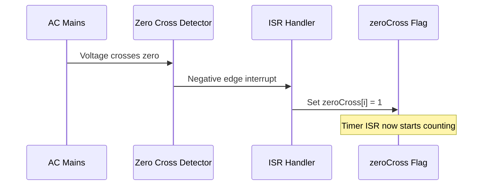
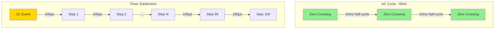
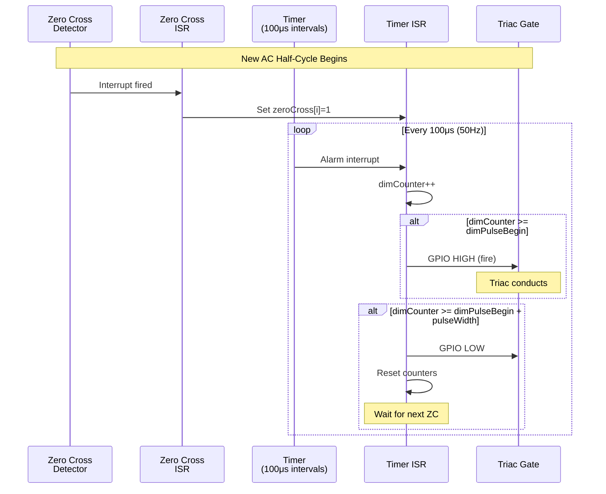
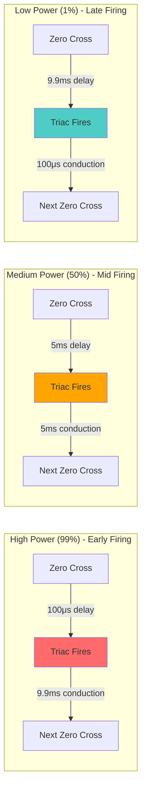
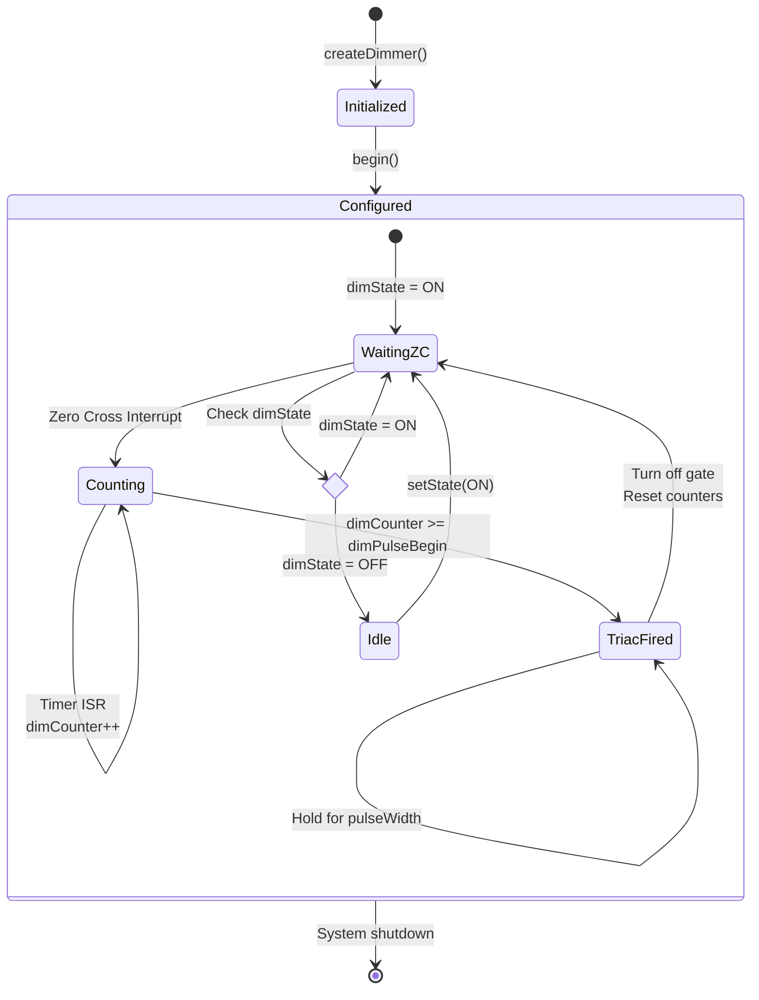
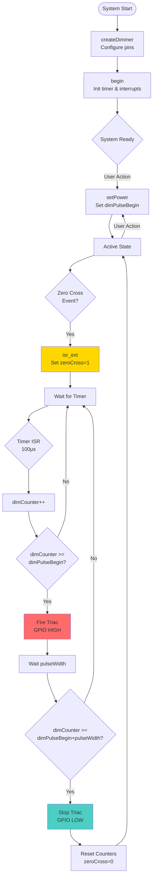

# Triac Cycle Documentation

## Table of Contents
1. [Overview](#overview)
2. [Zero Crossing Detection](#zero-crossing-detection)
3. [Delay Calculation](#delay-calculation)
4. [Timer Configuration](#timer-configuration)
5. [Triac Control Sequence](#triac-control-sequence)
6. [Power Level Mapping](#power-level-mapping)
7. [System Diagrams](#system-diagrams)

## Overview

This document provides a detailed explanation of the triac dimmer control cycle, including zero crossing detection, delay calculation, and the timing mechanisms used to control AC power delivery to the load.

### What is a Triac?

A TRIAC (Triode for Alternating Current) is a bidirectional semiconductor device used to control AC power. By firing the triac at specific moments during the AC cycle, we can control the amount of power delivered to the load (dimming effect).

### Basic Principle

The dimmer works by:
1. Detecting when the AC voltage crosses zero (zero crossing)
2. Waiting for a calculated delay period
3. Firing the triac to conduct current for the remainder of the half-cycle
4. Repeating for each half-cycle (100 or 120 times per second for 50Hz or 60Hz respectively)

## Zero Crossing Detection

### Hardware Configuration

The zero crossing detector circuit monitors the AC mains voltage and generates a pulse each time the voltage crosses zero volts. This typically happens twice per AC cycle (once on the positive-to-negative transition and once on the negative-to-positive transition).

**Key Implementation Details:**
- **GPIO Configuration:** The zero crossing pin is configured as an input with a pull-up resistor
- **Interrupt Type:** Negative edge triggered interrupt (`GPIO_INTR_NEGEDGE`)
- **Interrupt Handler:** `isr_ext()` function is called on each zero crossing event

### Zero Crossing ISR

```c
static void IRAM_ATTR isr_ext(void *arg)
{
    for (int i = 0; i < current_dim; i++)
        if (dimState[i] == ON)
        {
            zeroCross[i] = 1;
        }
}
```

**What Happens:**
1. Zero crossing interrupt fires when AC voltage crosses zero
2. For each active dimmer (state = ON), the `zeroCross[i]` flag is set to 1
3. This flag signals the timer ISR that a new half-cycle has begun
4. The timer ISR will start counting from this point to determine when to fire the triac

### Zero Crossing Timing Diagram



## Delay Calculation

### AC Frequency and Half-Cycle Period

The system supports both 50Hz and 60Hz AC mains frequencies:

**50Hz System:**
- Full cycle period: 1/50 = 20ms
- Half-cycle period: 10ms
- Number of half-cycles per second: 100

**60Hz System:**
- Full cycle period: 1/60 = 16.67ms
- Half-cycle period: 8.33ms
- Number of half-cycles per second: 120

### Timer Interval Calculation

The timer is configured to divide each half-cycle into 100 equal steps:

```c
double m_calculated_interval = (1 / (double)(ACfreq * 2)) / 100;
```

**Formula Breakdown:**
- `ACfreq * 2`: Number of half-cycles per second (e.g., 50 * 2 = 100 for 50Hz)
- `1 / (ACfreq * 2)`: Duration of one half-cycle in seconds
- `/ 100`: Divide the half-cycle into 100 steps

**Examples:**
- **50Hz:** interval = (1 / 100) / 100 = 0.0001s = 100μs per step
- **60Hz:** interval = (1 / 120) / 100 = 0.0000833s = 83.3μs per step

### Power to Delay Mapping

The power level (0-99) is mapped to a delay counter value using the `powerBuf[]` array:

```c
static const uint8_t powerBuf[] = {
    100, 99, 98, 97, 96, 95, 94, 93, 92, 91,
    // ... continues to ...
    10, 9, 8, 7, 6, 5, 4, 3, 2, 1
};
```

**Key Points:**
- Power level 0 → delay counter 100 (maximum delay, minimum power)
- Power level 99 → delay counter 1 (minimum delay, maximum power)
- The mapping is inverted: higher power = shorter delay
- This is because firing the triac earlier in the cycle delivers more power

**Setting Power:**
```c
void setPower(dimmertyp *ptr, int power)
{
    if (power >= 99)
        power = 99;
    dimPower[ptr->current_num] = power;
    dimPulseBegin[ptr->current_num] = powerBuf[power];
}
```

## Timer Configuration

### Timer Hardware Setup

The system uses ESP32's general-purpose timer (GPTimer) with the following configuration:

```c
gptimer_config_t m_timer_config = {
    .clk_src = GPTIMER_CLK_SRC_DEFAULT,
    .direction = GPTIMER_COUNT_UP,
    .resolution_hz = 1000000  // 1MHz = 1μs resolution
};
```

**Timer Properties:**
- **Clock Resolution:** 1MHz (each tick = 1μs)
- **Count Direction:** Up-counting
- **Auto-reload:** Enabled (timer restarts automatically)
- **Alarm Count:** Calculated based on AC frequency

### Alarm Configuration

```c
gptimer_alarm_config_t alarm_config = {
    .reload_count = 0,
    .alarm_count = (1000000 * m_calculated_interval),
    .flags.auto_reload_on_alarm = true
};
```

**For 50Hz:**
- alarm_count = 1000000 * 0.0001 = 100 ticks (100μs)

**For 60Hz:**
- alarm_count = 1000000 * 0.0000833 = 83.3 ticks (83.3μs)

## Triac Control Sequence

### Timer ISR Operation

The timer interrupt (`onTimerISR`) fires every 100μs (for 50Hz) and performs the following sequence:

```c
static void IRAM_ATTR onTimerISR(void *para)
{
    toggleCounter++;
    for (k = 0; k < current_dim; k++)
    {
        if (zeroCross[k] == 1)
        {
            dimCounter[k]++;
            
            // Check if it's time to fire the triac
            if (dimCounter[k] >= dimPulseBegin[k])
            {
                gpio_set_level(dimOutPin[k], 1);  // Fire triac
            }
            
            // Check if pulse width is complete
            if (dimCounter[k] >= (dimPulseBegin[k] + pulseWidth))
            {
                gpio_set_level(dimOutPin[k], 0);  // Turn off trigger
                zeroCross[k] = 0;                 // Reset for next cycle
                dimCounter[k] = 0;                // Reset counter
            }
        }
    }
}
```

### Firing Sequence Steps

1. **Zero Crossing Detected:** `zeroCross[k]` is set to 1
2. **Timer Counting:** Each timer interrupt increments `dimCounter[k]`
3. **Delay Complete:** When `dimCounter[k] >= dimPulseBegin[k]`, the triac is fired
4. **Pulse Duration:** The triac gate pulse is held for `pulseWidth` timer ticks (default: 2 ticks = 200μs)
5. **Pulse End:** After pulse width, the gate is turned off and counters are reset
6. **Cycle Complete:** System waits for next zero crossing

### Pulse Width

```c
int pulseWidth = 2;  // 2 timer ticks = 200μs for 50Hz
```

The triac gate pulse must be long enough to ensure the triac latches on, but short enough to not waste energy. A typical value is 200μs.

## Power Level Mapping

### Power vs Phase Angle

The relationship between power level and firing angle:

| Power Level | Delay Steps | Delay Time (50Hz) | Phase Angle | Approximate Power |
|-------------|-------------|-------------------|-------------|-------------------|
| 99          | 1           | 100μs            | ~1.8°       | ~99%             |
| 75          | 25          | 2.5ms            | ~45°        | ~75%             |
| 50          | 50          | 5.0ms            | ~90°        | ~50%             |
| 25          | 75          | 7.5ms            | ~135°       | ~25%             |
| 1           | 99          | 9.9ms            | ~178°       | ~1%              |

**Phase Angle Calculation:**
- Phase angle (degrees) = (delay_time / half_cycle_time) * 180°
- Example for power level 50: (5.0ms / 10ms) * 180° = 90°

## System Diagrams

### AC Cycle and Zero Crossing



### Timing Sequence Diagram



### Power Control Timing



### System State Machine



### Complete System Flow



## Toggle Mode

The system also supports a toggle mode where the power level automatically oscillates between minimum and maximum values.

### Toggle Mode Operation

```c
if (dimMode[k] == TOGGLE_MODE)
{
    if (dimPulseBegin[k] >= togMax[k])
        togDir[k] = false;  // Start decreasing
    
    if (dimPulseBegin[k] <= togMin[k])
        togDir[k] = true;   // Start increasing
    
    if (toggleCounter == toggleReload)
    {
        if (togDir[k] == true)
            dimPulseBegin[k]++;
        else
            dimPulseBegin[k]--;
    }
}
```

### Toggle Mode Diagram


## Key Formulas Summary

### 1. Timer Interval Calculation
```
interval = (1 / (frequency * 2)) / 100
```
- For 50Hz: interval = 100μs
- For 60Hz: interval = 83.3μs

### 2. Delay Time Calculation
```
delay_time = dimPulseBegin * timer_interval
```
- Example: dimPulseBegin=50, interval=100μs → delay = 5000μs = 5ms

### 3. Phase Angle Calculation
```
phase_angle = (delay_time / half_cycle_time) * 180°
```
- Example: (5ms / 10ms) * 180° = 90°

### 4. Conduction Time
```
conduction_time = half_cycle_time - delay_time
```
- Example: 10ms - 5ms = 5ms

### 5. Approximate Power Delivered
```
power ≈ (conduction_time / half_cycle_time) * 100%
```
- Example: (5ms / 10ms) * 100% = 50%

## Hardware Timing Characteristics

### Critical Timing Parameters

| Parameter | Value | Notes |
|-----------|-------|-------|
| Timer Resolution | 1μs | ESP32 GPTimer |
| Timer Interval (50Hz) | 100μs | 100 steps per half-cycle |
| Timer Interval (60Hz) | 83.3μs | 100 steps per half-cycle |
| Triac Pulse Width | 200μs | 2 timer ticks |
| Zero Cross Detection | < 1μs | Hardware dependent |
| ISR Response Time | < 10μs | Typical for ESP32 |

### Precision Considerations

- **Timer Jitter:** ESP32 timer has minimal jitter (~1-2μs)
- **ISR Latency:** Zero crossing ISR latency is typically < 10μs
- **Phase Accuracy:** Phase angle accuracy is approximately ±1-2 degrees
- **Power Accuracy:** Power level accuracy is approximately ±1-2%

## Code Reference

### Key Files
- **Implementation:** `src/components/esp32-triac-dimmer-driver/esp32-triac-dimmer-driver.c`
- **Header:** `src/components/esp32-triac-dimmer-driver/include/esp32-triac-dimmer-driver.h`
- **Example:** `src/examples/base/main.c`

### Key Functions

1. **createDimmer()** - Line 40: Initialize dimmer structure
2. **begin()** - Line 197: Configure timer and interrupts
3. **setPower()** - Line 231: Set power level (0-99)
4. **isr_ext()** - Line 301: Zero crossing interrupt handler
5. **onTimerISR()** - Line 321: Timer interrupt handler (main control loop)
6. **config_timer()** - Line 93: Configure GPTimer
7. **config_alarm()** - Line 68: Configure timer alarm

## Future Design Considerations

This documentation serves as a foundation for future enhancements:

1. **PID Control Integration:** Add closed-loop power control
2. **Power Factor Correction:** Implement leading/trailing edge control
3. **Multi-Phase Support:** Extend to 3-phase AC systems
4. **Energy Monitoring:** Add real-time power consumption tracking
5. **Soft Start:** Implement gradual power ramp-up
6. **Overload Protection:** Add current sensing and protection
7. **Remote Control:** MQTT/WiFi integration for IoT applications
8. **Calibration Mode:** Auto-calibrate for different AC frequencies and loads

## References

- ESP32 GPTimer API Documentation
- Triac Phase Control Theory
- AC Power Control Techniques
- ESP-IDF v5.x GPIO and Interrupt Handling

---

**Document Version:** 1.0  
**Last Updated:** 2026-01-25  
**Author:** ESP32 Triac Dimmer Driver Documentation
